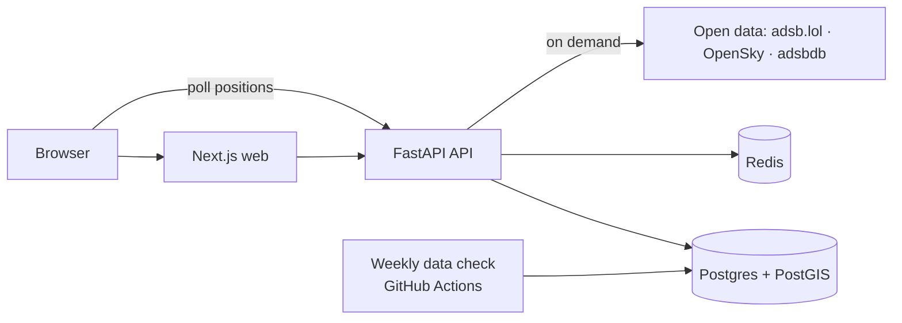

# AeroGuide

AeroGuide is a free, non-commercial aviation and airport intelligence website for India. It combines live flight tracking, airport guides, lounge discovery and credit-card lounge eligibility on one site. It uses **open data only** and runs on **free tiers at $0**. Every fact on it is sourced and dated, or clearly marked as unverified or demo.

> **Status: Stage 1 (foundation).** App shell, API health check and tooling are in place. Features arrive from Stage 2. See [Implementation status](#implementation-status).

## Features (planned for the MVP)

- **Live flight map.** Full-screen MapLibre map of aircraft over India from open ADS-B networks (adsb.lol, OpenSky). Select a plane for its reported route, altitude, speed, heading and estimated arrival. Shows the data source, the last-updated time and an explicit **DEMO DATA** mode.
- **Flight details.** `/flight/AI101` with live state, reported route and recently observed flights. Airline schedules, gates and delays aren't available from open data, and the page says so.
- **Airport guides.** DEL, BOM, BLR, HYD, MAA, COK, JAI: terminals, airlines by terminal, lounges, dining, shopping, transport and facilities.
- **Lounge directory.** Search and filter by airport, terminal, domestic or international, and amenities.
- **Card lounge access.** Directory of cards with versioned lounge policies, and a deterministic eligibility checker.

## Screenshots

None yet. They will be added from Stage 2 onward.

## Technology stack

| Layer | Technology |
|---|---|
| Web | Next.js (App Router), TypeScript, Tailwind CSS, shadcn/ui, Lucide, MapLibre GL JS, TanStack Query |
| API | Python 3.12, FastAPI, Pydantic, SQLAlchemy, Alembic |
| Data | PostgreSQL + PostGIS, Redis |
| Deploy ($0) | Vercel Hobby (web), Render free (API), Supabase free (Postgres), Upstash free (Redis), GitHub Actions (CI + weekly data check) |

## Architecture



Details: [system architecture](docs/architecture/system-architecture.md) · [ADRs](docs/decisions/README.md)

## Repository structure

```text
.
├── apps/
│   ├── web/          # Next.js 16 app (App Router, Tailwind v4, shadcn/ui)
│   └── api/          # FastAPI app, Alembic migrations, scheduled jobs
├── docs/
│   ├── api/          # API contract
│   ├── architecture/ # system, frontend, backend, database, data flow, deployment
│   ├── database/     # ERD, schema, data dictionary
│   ├── decisions/    # ADRs
│   ├── planning/     # PRD, MVP scope, roadmap, backlog, implementation plan
│   ├── research/     # provider and data-source research
│   └── testing/      # testing strategy
├── .github/workflows # CI
├── docker-compose.yml # local Postgres+PostGIS and Redis
└── Makefile          # dev commands (mirrored as root pnpm scripts)
```

## Setup, environment, migrations, running and testing

Prerequisites: Node 22+, pnpm, Python 3.12, uv, Docker.

```bash
pnpm install && pnpm install:api
cp apps/api/.env.example apps/api/.env
cp apps/web/.env.example apps/web/.env.local
pnpm up          # Postgres+PostGIS and Redis
pnpm migrate     # alembic upgrade head
pnpm dev:api     # http://localhost:8000/api/v1/health
pnpm dev:web     # http://localhost:3000
pnpm test        # unit tests (web + API)
```

The full command list, environment variables and notes are in the [local development guide](docs/deployment/local-development.md).

## Deployment

Planned, on free tiers only. See the [deployment architecture](docs/architecture/deployment-architecture.md) and [ADR-0012](docs/decisions/0012-zero-budget-hosting.md).

A weekly GitHub Actions job checks content staleness, source links and the open data APIs, and opens a `data-check` issue ([ADR-0013](docs/decisions/0013-weekly-data-check.md)).

## Implementation status

| Stage | Status |
|---|---|
| 0 Research and planning | Done |
| 1 Foundation | In review: web shell and placeholder pages, API with `/api/v1/health`, first migration (extensions), Docker Compose, CI |
| 2 Frontend design system | Not started |
| 3 Airports | Not started |
| 4 Flight tracking | Not started |
| 5 Lounges and cards | Not started |
| 6 Testing and deployment | Not started |

## Roadmap

See [docs/planning/roadmap.md](docs/planning/roadmap.md). AI features are deliberately deferred to a later phase ([ADR-0008](docs/decisions/0008-defer-ai-integration.md)).

## Data sources and attribution

Live positions come from open community ADS-B networks (adsb.lol, data under ODbL 1.0; OpenSky Network, non-commercial terms). Reported routes come from adsbdb. Map data is © OpenStreetMap contributors. All are credited in the UI. Airport, lounge and card information comes from official sources, cited on each record. See [docs/research/](docs/research/).

## Contributing and licence

See [CONTRIBUTING.md](CONTRIBUTING.md).

The code is licensed under the [MIT License](LICENSE). Third-party data shown by AeroGuide stays under its own licence and terms.
