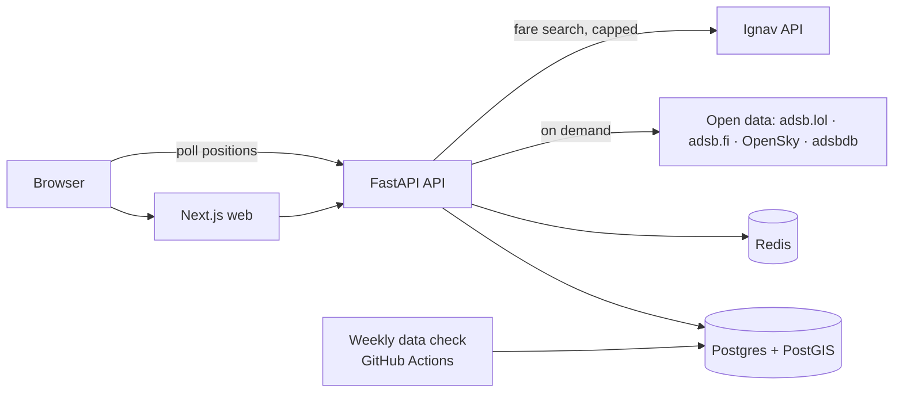

# AeroGuide

AeroGuide is a free, non-commercial aviation and airport intelligence website for India. It combines live flight tracking, airport guides, lounge discovery, credit-card lounge eligibility and domestic fare search on one site. It runs on **free tiers at $0** and uses **open data**, with one exception: fares come from the Ignav API within a hard request budget that keeps it free ([ADR-0015](docs/decisions/0015-paid-fare-search-with-a-request-budget.md)). Every fact on it is sourced and dated, or clearly marked as unverified or demo.

> **Status:** live at https://aeroguide-theta.vercel.app. See [Implementation status](#implementation-status).

## Features

- **Live flight map.** Full-screen MapLibre map of aircraft over India from open ADS-B networks (adsb.lol, adsb.fi, OpenSky). Select a plane for its reported route, altitude, speed, heading and estimated arrival. Shows the data source, how fresh it is and an explicit **DEMO DATA** mode.
- **Airport guides.** 116 Indian airports, with guides for DEL, BOM, BLR, HYD, MAA, COK and JAI.
- **Lounges and card lounge access.** Lounges at the 7 guide airports, 76 cards with versioned lounge policies, and a deterministic eligibility checker.
- **Fare search.** Compare one-way and round-trip fares on Indian domestic routes (`/fares`), sorted by best, cheapest or fastest, with filters and links to book.
- **Site search** (Ctrl/Cmd-K) and a read-only **MCP server** for AI assistants.

## Screenshots

None yet. They will be added from Stage 2 onward.

## Technology stack

| Layer | Technology |
|---|---|
| Web | Next.js (App Router), TypeScript, Tailwind CSS, shadcn/ui, Lucide, MapLibre GL JS, TanStack Query |
| API | Python 3.12, FastAPI, Pydantic, SQLAlchemy, Alembic |
| Data | PostgreSQL + PostGIS, Redis |
| Deploy ($0) | Vercel Hobby (web), Render free (API), Supabase free (Postgres), Upstash free (Redis), GitHub Actions (CI + weekly data check) |

## Architecture



Details: [system architecture](docs/architecture/system-architecture.md) · [ADRs](docs/decisions/README.md)

## Repository structure

```text
.
├── apps/
│   ├── web/          # Next.js 16 app (App Router, Tailwind v4, shadcn/ui)
│   └── api/          # FastAPI app, Alembic migrations, scheduled jobs
├── docs/
│   ├── api/          # API contract
│   ├── architecture/ # system, frontend, backend, database, data flow, deployment
│   ├── database/     # ERD, schema, data dictionary
│   ├── decisions/    # ADRs
│   ├── planning/     # PRD, MVP scope, roadmap, backlog, implementation plan
│   ├── research/     # provider and data-source research
│   └── testing/      # testing strategy
├── .github/workflows # CI
├── docker-compose.yml # local Postgres+PostGIS and Redis
└── Makefile          # dev commands (mirrored as root pnpm scripts)
```

## Setup, environment, migrations, running and testing

Prerequisites: Node 22+, pnpm, Python 3.12, uv, Docker.

```bash
pnpm install && pnpm install:api
cp apps/api/.env.example apps/api/.env
cp apps/web/.env.example apps/web/.env.local
pnpm up          # Postgres+PostGIS and Redis
pnpm migrate     # alembic upgrade head
pnpm dev:api     # http://localhost:8000/api/v1/health
pnpm dev:web     # http://localhost:3000
pnpm test        # unit tests (web + API)
```

The full command list, environment variables and notes are in the [local development guide](docs/deployment/local-development.md).

## Fare search

Compares fares on Indian domestic routes, one-way or round trip, from the [Ignav API](https://ignav.com/docs). Ignav gives 1,000 free requests once, then bills $2 per 1,000, so every request is counted and capped ([ADR-0015](docs/decisions/0015-paid-fare-search-with-a-request-budget.md)).

**How it works.** The `/fares` page calls the API's search service, `POST /api/v1/fares/search`:

1. It checks that both airports are Indian airports AeroGuide lists, before spending anything.
2. It looks in a 10-minute cache.
3. On a miss, it asks every fare provider at the same time, each with its own timeout. Each provider is an adapter behind one `FlightProvider` interface: Ignav, or the demo provider.
4. It merges and dedupes the offers, drops itineraries that connect outside India, and caches the result if every provider answered.
5. It applies the filters (stops, airlines, departure time, price) and sorts by best, cheapest or fastest.

"Best" weighs price, duration and stops with `FARES_BEST_WEIGHTS`. Filters and sorting run on the cached results, so changing them costs no request. Booking links (`POST /api/v1/fares/booking-links`) are fetched only when someone clicks Book. Airport autocomplete uses AeroGuide's own airport list (`/api/v1/airports?q=`), never Ignav's billable airport search.

**The request budget.** Before every Ignav request, retries included, one unit is reserved in Postgres (`provider_usage`, migration 0007). The check and the increment happen in one locked transaction. If the counter can't be reached, nothing is sent.
- At 95% of the cap, every search shows a gentle "Heads up: N of M fare searches used".
- At the cap, searches stop with a clear message until the cap is raised.
- `GET /api/v1/fares/budget` shows the current usage.

**Setup.** Set these in `apps/api/.env` locally, or in Render's environment. Never commit the key: `.env` is git-ignored.

| Variable | Default | Meaning |
|---|---|---|
| `IGNAV_API_KEY` | empty | Ignav key. Empty turns fare search off (the API answers 503) |
| `FARE_PROVIDERS` | `ignav` | `mock` gives generated **demo** fares, labelled as such, for offline work |
| `IGNAV_MARKET` | `IN` | Indian market: prices in INR |
| `FARES_TOTAL_REQUEST_CAP` | `900` | Lifetime cap, below the 1,000 free requests |
| `FARES_DAILY_REQUEST_CAP` | `100` | Per IST day. Empty means no daily cap |
| `FARES_MONTHLY_REQUEST_CAP` | empty | Optional, for when billing is on |
| `FARES_BUDGET_WARN_RATIO` | `0.95` | When the reminder appears |
| `FARES_CACHE_TTL_S` | `600` | Result cache, 60 to 3,600 s |
| `FARES_BEST_WEIGHTS` | `0.6,0.3,0.1` | Price, duration, stops |
| `FARES_RATE_LIMIT_PER_MINUTE` | `10` | Per client, on `/api/v1/fares/*` |
| `FARES_MCP_DAILY_REQUEST_CAP` | `20` | Live searches by AI assistants through the MCP tool `search_flights`, per IST day, inside the caps above |

**Running it.** Run `pnpm migrate` (creates `provider_usage`), then the API and web as above, then open http://localhost:3000/fares. For demo fares that cost nothing, set `FARE_PROVIDERS=mock`. The tests never call Ignav: they use fixtures and a mock transport, and blank the key.

**Coverage check.** Run this rarely. Each route is one billable request.

```bash
cd apps/api
uv run python scripts/check_ignav_coverage.py         # dry run: prints the plan, sends nothing
uv run python scripts/check_ignav_coverage.py --yes   # 3 requests: DEL-BOM, BLR-HYD, CCU-GAU
```

It prints the airlines returned per route and whether IndiGo, Air India Express, Akasa Air and SpiceJet appear. These requests aren't counted by the app's budget, which is why the app's cap stays below 1,000.

## Deployment

On free tiers: Vercel (web), Render (API), Supabase (Postgres). See the [deployment architecture](docs/architecture/deployment-architecture.md) and [ADR-0012](docs/decisions/0012-zero-budget-hosting.md).

A weekly GitHub Actions job checks content staleness, source links and the open data APIs, and opens a `data-check` issue ([ADR-0013](docs/decisions/0013-weekly-data-check.md)).

## Implementation status

| Stage | Status |
|---|---|
| 0 Research and planning | Done |
| 1 Foundation | Done: web shell, API with `/api/v1/health`, first migration (extensions), Docker Compose, CI |
| 2 Frontend design system | Done: dark/light theme, mobile navigation, data-honesty components, axe clean in both themes |
| 3 Airports | Shipped: 116 airports, 7 guides. Verified terminal assignments still to do |
| 4 Flight tracking | Shipped: live map homepage, positions API with adsb.lol, adsb.fi and OpenSky, routes, weather, watch alerts. Flight detail page still to do |
| 5 Lounges and cards | Shipped: 44 lounges, 76 cards (15 verified), eligibility checker |
| Fare search | Shipped: Ignav fare search for Indian domestic routes with a request budget ([ADR-0015](docs/decisions/0015-paid-fare-search-with-a-request-budget.md)) |
| 6 Testing and deployment | In progress: deployed at $0; monitoring still to do |

## Roadmap

See [docs/planning/roadmap.md](docs/planning/roadmap.md). AI assistants can use AeroGuide through its read-only MCP server: see [docs/api/mcp.md](docs/api/mcp.md) and [ADR-0014](docs/decisions/0014-mcp-server-for-ai-assistants.md).

## Data sources and attribution

Live positions come from open community ADS-B networks (adsb.lol, data under ODbL 1.0; adsb.fi, personal non-commercial use with credit; OpenSky Network, non-commercial terms). Reported routes come from adsbdb. Fares come from Ignav under its terms. Map data is © OpenStreetMap contributors. All are credited in the UI. Airport, lounge and card information comes from official sources, cited on each record. See [docs/research/](docs/research/).

## Contributing and licence

See [CONTRIBUTING.md](CONTRIBUTING.md).

The code is licensed under the [MIT License](LICENSE). Third-party data shown by AeroGuide stays under its own licence and terms.
