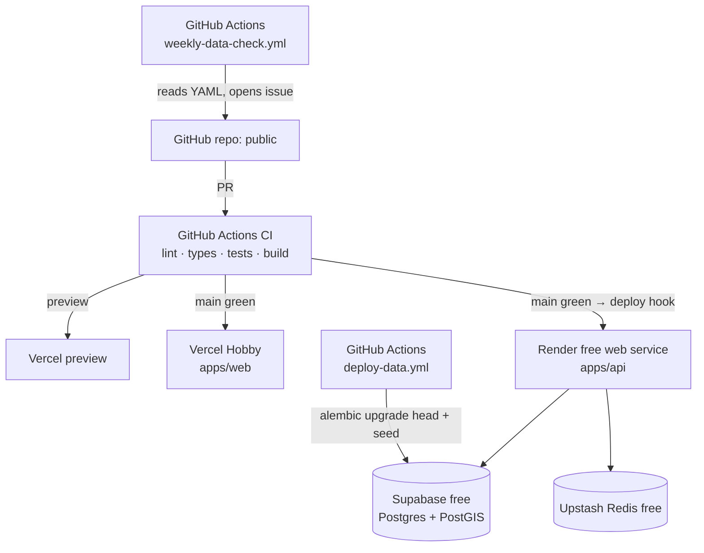

# Deployment architecture

Last updated: 2026-11-13. Status: proposed. Nothing is deployed yet. **Budget: $0** ([ADR-0012](../decisions/0012-zero-budget-hosting.md)).

| Component | Target (free tier) | Notes |
|---|---|---|
| Web | Vercel Hobby | Root `apps/web`. Non-commercial use only, which matches AeroGuide. Content pages are static or ISR, so they work while the API sleeps |
| API | Render free web service | Docker image from `apps/api`. Sleeps after 15 min idle, about 1 min cold start. Health check at `/api/v1/health`. The free tier has no pre-deploy command, so migrations and seed run from `deploy-data.yml` |
| Postgres | Supabase free | 500 MB, PostGIS enabled. Pauses after 1 week without DB activity ([ADR-0013](../decisions/0013-weekly-data-check.md) covers this risk) |
| Redis | Upstash free | 500K commands a month. **No payment card added**, so it can't upgrade to paid usage |
| Jobs | GitHub Actions (free for public repos) | CI. Weekly data check. Deploy data (migrations + seed on changes to `main`, skipped until the `DATABASE_URL` secret exists) |
| Map tiles | OpenFreeMap | Free, no key |

There is **no background worker** (Render has no free one). Live ingestion runs on demand inside the API.

## Connecting the database (Supabase)

1. Create a free Supabase project (region: Mumbai, `ap-south-1`). In *Database → Extensions*, PostGIS, pg_trgm and btree_gist can stay off: migration 0001 enables them.
2. Copy the **session pooler** connection string (port 5432; the direct host is IPv6-only and the transaction pooler on 6543 breaks asyncpg's prepared statements). Change the scheme to `postgresql+asyncpg://` and add `?ssl=require`.
3. Add it as the GitHub repository secret `DATABASE_URL`, then run *Actions → Deploy data → Run workflow* once.
4. Add the same value as `DATABASE_URL` in the Render service's environment. Render redeploys, and `/api/v1/health` reports the database and PostGIS as `ok`.

## Environments

`local` (Docker Compose: Postgres+PostGIS, Redis) → `preview` (Vercel previews against the same free API) → `production`.

## Secrets

Secrets live only in the Vercel, Render and GitHub Actions secret stores: `DATABASE_URL` (Render and GitHub), `REDIS_URL`, `OPENSKY_CLIENT_ID`, `OPENSKY_CLIENT_SECRET`. `.env.example` documents every variable without values. gitleaks runs in CI.

## Free-tier risks

| Risk | Mitigation |
|---|---|
| API cold start (about 1 min) | Static content pages. A "waking up" state on `/live`. Warm-start snapshot from Redis |
| Supabase pause after 7 idle days | Normal traffic plus the weekly job. Optional twice-weekly keep-alive (owner decision) |
| Upstash command cap | In-memory first. Redis writes capped at about 1 a minute plus cache misses |
| Free-tier terms change | Re-check pricing pages at each deploy. This doc and ADR-0012 list the limits we depend on |
