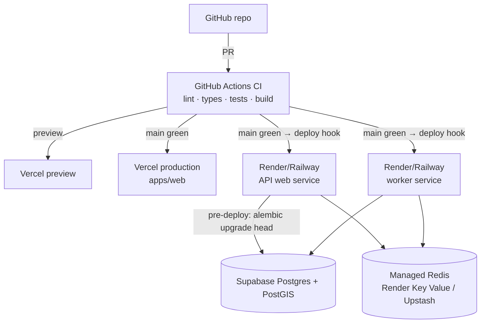

# Deployment architecture

Last updated: 2026-11-13. Status: proposed. Nothing is deployed yet.

| Component | Target | Notes |
|---|---|---|
| Web | Vercel | Root `apps/web`. Env: `API_BASE_URL` (server-side), `NEXT_PUBLIC_API_BASE_URL` (browser polling). |
| API | Render web service or Railway service | Docker image from `apps/api`. Pre-deploy runs migrations. Health check at `/api/v1/health`. |
| Worker | Render background worker or Railway service | **Same image**, different command (`python -m app.workers.ingest_positions`). Must be always on, so free tiers that sleep won't work. |
| Postgres | Supabase | PostGIS extension enabled. Backups through the provider. |
| Redis | Render Key Value, Railway Redis or Upstash | Ephemeral data only, so loss is tolerable. |

## Environments

`local` (Docker Compose) → `preview` (Vercel previews against a shared staging API) → `production`.

## Secrets

Secrets are held only in the platform secret stores and GitHub Actions secrets. `.env.example` documents every variable without values. A secret-scan (gitleaks) step runs in CI.

## Cost notes (verify at deploy time)

An always-on worker and a managed Redis are the main fixed costs. Operational flight data is usage-based ([provider research](../research/aviation-data-providers.md)).
