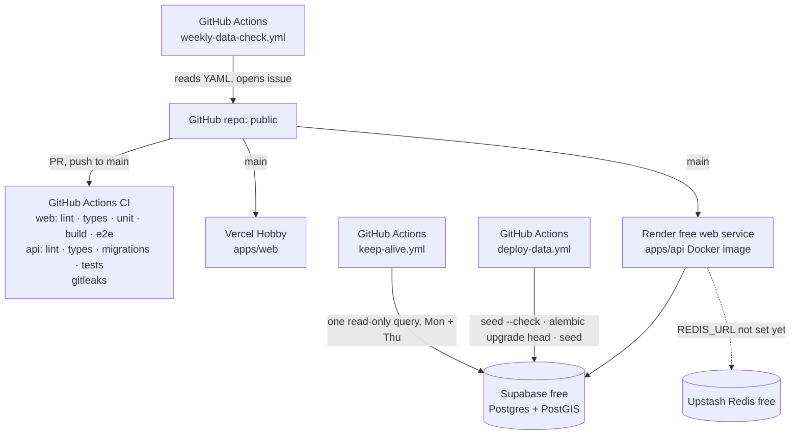

# Deployment architecture

Last updated: 2026-11-16. Status: implemented. Live at https://aeroguide-theta.vercel.app (web) and https://aeroguide-erq3.onrender.com (API, MCP at `/mcp`). **Budget: $0** ([ADR-0012](../decisions/0012-zero-budget-hosting.md)), plus Ignav's one-time free allowance for fare search ([ADR-0015](../decisions/0015-paid-fare-search-with-a-request-budget.md)).

| Component | Target (free tier) | Notes |
|---|---|---|
| Web | Vercel Hobby | Root `apps/web`. Non-commercial use only, which matches AeroGuide. Content pages are prerendered (`generateStaticParams` for airports, lounges and cards; `use cache` for server reads), so they work while the API sleeps |
| API | Render free web service | Docker image from `apps/api` (`uvicorn` on `$PORT`, `--proxy-headers`). Sleeps after 15 min idle, about 1 min cold start. Health check at `/api/v1/health`. The free tier has no pre-deploy command, so migrations and seed run from `deploy-data.yml`. `RENDER_EXTERNAL_HOSTNAME` is read to allow the host on `/mcp` |
| Postgres | Supabase free | 500 MB, PostGIS enabled. Pauses after 1 week without DB activity: `keep-alive.yml` runs `app.jobs.ping_db` on Mondays and Thursdays |
| Redis | Upstash free | 500K commands a month. **No payment card added**, so it can't upgrade to paid usage. Created, but `REDIS_URL` isn't set on Render yet, so `/api/v1/health` reports Redis as `disabled` and the live snapshot, route cache and fare cache stay in process memory |
| Jobs | GitHub Actions (free for public repos) | CI. Weekly data check. Database keep-alive. Deploy data (migrations + seed on changes to migrations, data, models or the seed loader on `main`, skipped when the `DATABASE_URL` secret is missing) |
| Map tiles | OpenFreeMap | Free, no key. Weather radar from RainViewer |
| Fares | Ignav | Paid API after a free allowance; counted in `provider_usage` and capped (900 lifetime, 100 a day, 20 a day via MCP by default) |

There is **no background worker** (Render has no free one). Live ingestion runs on demand inside the API, and airline sightings are flushed to Postgres from the same process every 5 minutes.

## Connecting the database (Supabase)

1. Create a free Supabase project (region: Mumbai, `ap-south-1`). In *Database → Extensions*, PostGIS, pg_trgm and btree_gist can stay off: migration 0001 enables them.
2. Copy the **session pooler** connection string (port 5432; the direct host is IPv6-only and the transaction pooler on 6543 breaks asyncpg's prepared statements). Paste it as shown: the API switches `postgresql://` to the asyncpg driver and `sslmode=` to `ssl=` itself (`normalise_database_url` in `app/core/config.py`).
3. Add it as the GitHub repository secret `DATABASE_URL`, then run *Actions → Deploy data → Run workflow* once.
4. Add the same value as `DATABASE_URL` in the Render service's environment. Render redeploys, and `/api/v1/health` reports the database and PostGIS as `ok`.

## Environments

`local` (Docker Compose: Postgres+PostGIS, Redis) → `preview` (Vercel previews against the same free API) → `production`.

## Secrets

Secrets live only in the Vercel, Render and GitHub Actions secret stores: `DATABASE_URL` (Render and GitHub), `REDIS_URL` (Render, not set yet), `OPENSKY_CLIENT_ID`, `OPENSKY_CLIENT_SECRET`, `IGNAV_API_KEY` (Render; without it fare search is off and the API still starts). The web app needs only the public `NEXT_PUBLIC_API_BASE_URL` (or `API_BASE_URL` for server reads). Every variable is documented without values in the root README and [docs/deployment/local-development.md](../deployment/local-development.md). gitleaks runs in CI.

## Free-tier risks

| Risk | Mitigation |
|---|---|
| API cold start (about 1 min) | Prerendered content pages. A "waking up" state on the live map and content pages. Warm-start snapshot from Redis once `REDIS_URL` is set |
| Supabase pause after 7 idle days | Normal traffic plus the twice-weekly `keep-alive.yml` ping (the weekly data check reads YAML only, not the database) |
| Upstash command cap | In-memory first. Redis writes capped at about 1 a minute plus cache misses |
| Fare search allowance runs out | Hard caps in `provider_usage` checked before every upstream request; the UI shows "Heads up" at 95 % and the API answers `429` at the cap |
| Free-tier terms change | Re-check pricing pages at each deploy. This doc and ADR-0012 list the limits we depend on |
