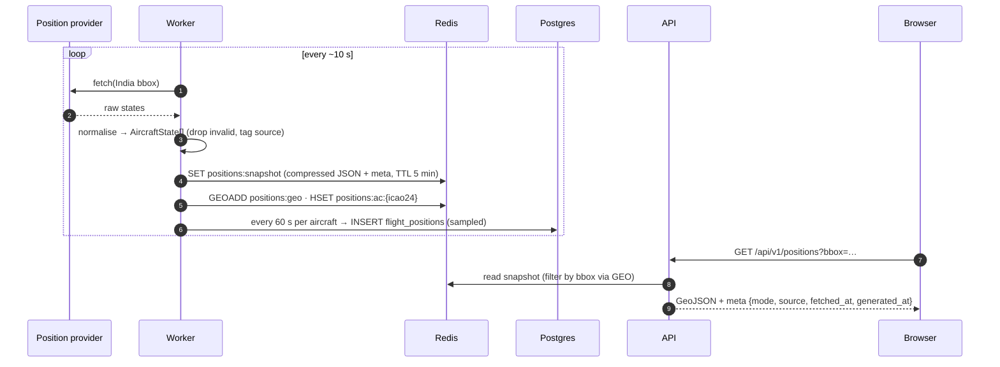
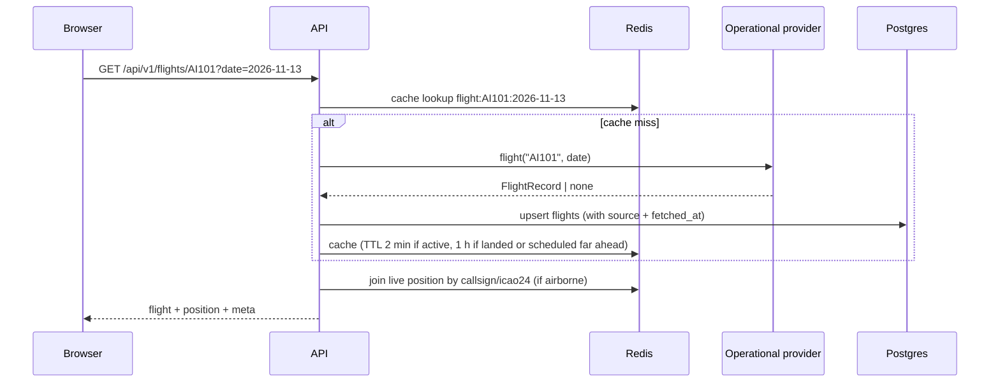

# Flight data flow

Last updated: 2026-11-13. Status: proposed.

## Live positions



### Response `meta`

```json
{
  "mode": "live",               // "live" | "demo" | "degraded" | "unavailable"
  "source": "adsb.lol",
  "source_url": "https://adsb.lol",
  "attribution": "Data © adsb.lol contributors, ODbL",
  "fetched_at": "2026-11-13T13:10:03Z",
  "generated_at": "2026-11-13T13:10:05Z",
  "count": 612
}
```

### Freshness rules

| Age of a position (`now − position_time`) | Behaviour |
|---|---|
| < 60 s | Normal |
| 60 s – 5 min | Shown faded with "last seen X ago". No ETA |
| > 5 min | Removed from the map. Searchable as "last seen" for 30 min |

| Age of the whole snapshot | `meta.mode` |
|---|---|
| < 60 s | `live` (or `demo` if the demo provider is configured) |
| 60 s – 5 min | `degraded`, with a banner: "Live data delayed" |
| none or > 5 min | `unavailable`. The map shows basemap and airports with an explanation |

### Provider failover

The configured order is, for example, `POSITION_PROVIDERS=adsblol,opensky`. If the first provider fails, the worker tries the next. `meta.source` always names the provider that actually produced the data. **The demo provider is never in the automatic failover chain** ([ADR-0011](../decisions/0011-demo-mode-is-explicit.md)).

## Flight details (on demand)



With `OPERATIONAL_PROVIDER=none`, the endpoint returns only what the position data supports, with `schedule: null` and a reason the UI shows as "Schedule data not available".

## Identifier mapping

- Flight number (IATA, `AI101`) ↔ callsign (ICAO, `AIC101`): mapped by the airline's IATA/ICAO prefix pair from the `airlines` table. Numeric suffixes don't always match (callsigns can have letter suffixes), so the mapping is a **search hint**, confirmed only by the operational provider.
- Route from a community callsign lookup: shown only as **"reported route"** with its source. Hidden when the aircraft's track clearly contradicts it.

## Retention

- Redis: only the latest state (5 min TTL).
- `flight_positions`: sampled once a minute per aircraft, partitioned by day, kept **7 days** (configurable). This covers trails and debugging without bulk-redistributing provider data. Storage terms must be checked against each provider's licence ([provider research](../research/aviation-data-providers.md)).
