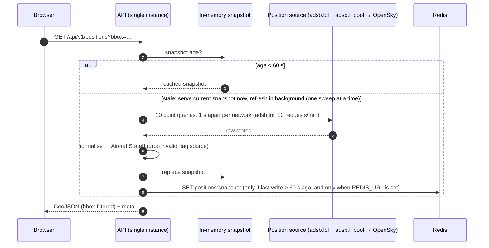
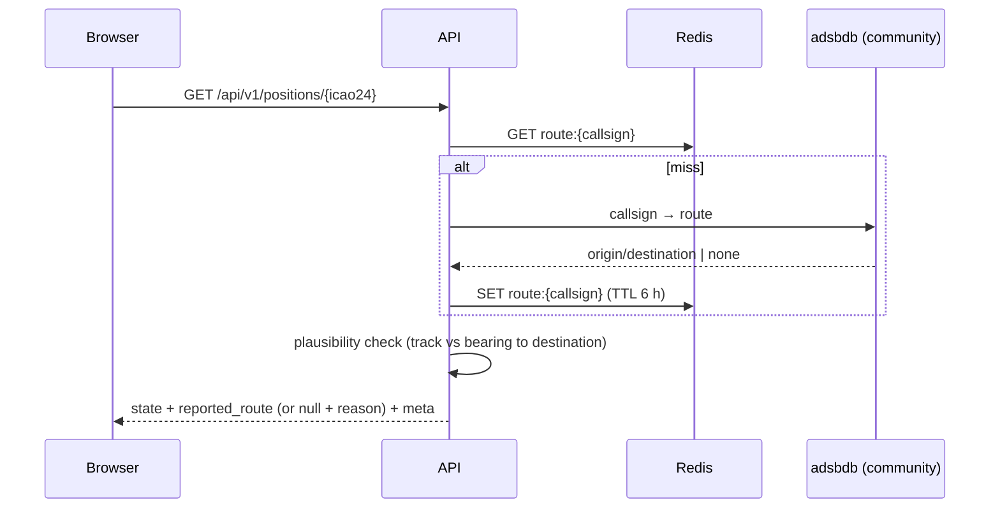

# Flight data flow

Last updated: 2026-11-16. Status: implemented. Open data only, zero budget ([ADR-0004](../decisions/0004-flight-provider-abstraction.md), [ADR-0012](../decisions/0012-zero-budget-hosting.md)).

## Live positions (on demand)



On a **cold start** the API first loads `positions:snapshot` from Redis, if one exists and is under 5 minutes old, so the first visitor sees something immediately, marked with its real age.

### Response `meta`

```json
{
  "mode": "live",               // "live" | "demo" | "degraded" | "unavailable"
  "source": "adsb.lol + adsb.fi",
  "source_url": "https://adsb.lol",
  "attribution": "Data © adsb.lol contributors, ODbL; Data from adsb.fi",
  "fetched_at": "2026-11-13T13:10:03Z",
  "generated_at": "2026-11-13T13:10:05Z",
  "count": 612,
  "message": null
}
```

`message` is a plain-language explanation whenever `mode` isn't `live`. For `unavailable` it says why the latest sweeps failed, built from the live service's `last_error`: "busy right now (they're limiting requests)" when every failure was a rate limit, otherwise "aren't responding right now", followed by "AeroGuide keeps trying every minute, and the map updates on its own." The same `last_error` is exposed on `GET /health`.

### Freshness rules

| Age of a position (`now − position_time`) | Behaviour |
|---|---|
| < 90 s | Live (sweeps run once a minute, so 0-70 s is normal) |
| 90 s – 5 min | Labelled "Delayed" with "last seen X ago" |
| > 5 min | Removed from the map |

| Age of the whole snapshot | `meta.mode` |
|---|---|
| < 90 s | `live` (or `demo` if the demo provider is configured) |
| 90 s – 5 min | `degraded`, with a banner: "Live data delayed" |
| none or > 5 min | `unavailable`. The map shows basemap and airports with an explanation |

### Source failover

The configured order is `POSITION_PROVIDERS=adsblol,adsbfi,opensky` (the default). If a source fails, the next is tried. A source that answers `429` rests for its `Retry-After` and is skipped until then.

**The readsb pool (since 2026-11-16).** When both `adsblol` and `adsbfi` are configured, `registry.py` joins them into one `ReadsbPool` source, named `adsb.lol + adsb.fi`, that fails over **point by point** rather than sweep by sweep:

- Each of the 10 grid points is asked of the currently preferred network. A `429` rests that network for its `Retry-After` and the *remaining* points go to the other network; the points already fetched are kept. A point that fails for another reason (timeout, 5xx) is retried on the other network, and that network is skipped for the rest of the sweep so a hanging host can't stall every point.
- Requests are spaced 1 s apart **per network**, so the pool never exceeds either network's limit.
- The pool sticks with whichever network answered most points, so a busy network isn't asked first every minute. Each aircraft is credited to the network that reported it (`source` on the row).
- The pool only raises a rate-limit error, and only then hands over to OpenSky, when every network is resting. The sweep rests for the shortest remaining `Retry-After`.
- `GET /health` lists how many seconds each resting network has left under `live.providers[...].resting_s`.

Why: on shared hosting both networks' per-address limits are often used up by other apps ([research](../research/aviation-data-providers.md#lesson-from-the-first-deployment-2026-11-13)). Before the pool, a `429` on the second point of a sweep failed the whole sweep, then the next source did the same, and the map showed "unavailable" even though each network could still have answered most points.

A sweep fails if more than 2 of its 10 regions don't answer, so a half-empty map is never shown as complete.

**Coverage:** the 10-point grid (used by the adsb.lol + adsb.fi pool) reaches every Indian airport with scheduled service except the island airports Agatti (AGX) and Port Blair (IXZ). OpenSky (fallback) covers the whole bounding box but reports no aircraft type or registration. `meta.source` always names the source that actually produced the data. **The demo provider is never in the automatic failover chain** ([ADR-0011](../decisions/0011-demo-mode-is-explicit.md)).

### Motion between updates (browser)

The browser polls every 15 s and the API sweeps once a minute, so a position is normally 0-75 s old. Rather than leave every plane frozen between updates, the map applies **dead reckoning** (`apps/web/src/components/live/motion.ts`): an airborne aircraft with a ground speed of at least 40 kt and a known track is drawn where that speed and track would have taken it since `position_time`, along a great circle. The map redraws twice a second while the tab is visible. The estimate is capped at 75 s past the last report (a little more than one sweep), is never applied to aircraft on the ground, and is replaced by the real position at the next update. Because of the cap, delayed positions (`degraded`) move at most 75 s and then hold. Motion is switched off entirely when the data has expired (no update for 5 minutes, the map's faded state) and when the visitor prefers reduced motion. The legend states that positions between updates are estimates. The API and the flight panel always show the reported position and its age, never the estimate.

## Selected aircraft: reported route



## Selected flight panel (live map)

Open data gives **no schedules or airline status**, so there is no flight page; the live map's panel (`?f={icao24}`) is built from what can be observed:

| Section | Source | Shown as |
|---|---|---|
| Live state (position, altitude, speed, heading) | Live snapshot | "Live", with the reported position's age |
| Observed state | ADS-B | *Airborne* or *On ground*; a flight that drops out of the snapshot is *not tracked* |
| Origin and destination | adsbdb | "Reported route (community data)" |
| Estimated arrival | `progress` on `GET /positions/{icao24}`: remaining great-circle distance ÷ ground speed | "Estimated from live position" |
| Scheduled and estimated times, gate, delay, cancellation | — | **"Not available from open data sources"** |

## Airlines seen at an airport

Airport pages show which airlines were seen at the airport, from the live snapshot rather than from a movements feed: an aircraft on the ground, or within 3,000 ft of the airport's elevation and 6 km of the reference point, is recorded as a sighting of its callsign's airline for that IST day (`ingestion/sightings.py`, table `airport_sightings`, flushed every 5 minutes, kept 45 days) and served by `GET /airports/{code}/airlines-seen`. It's an observation, never a schedule or a terminal claim. The OpenSky `/flights/departure` and `/flights/arrival` "movements" feature from the first plan was not built.

## Reported routes (background)

After each sweep, up to 10 callsigns without a cached route are looked up on adsbdb (3 at a time) and cached for 6 h, including "no route" answers. The route list fills in over a few minutes while people are viewing. adsb.lol's batch route endpoint was tested and returns an empty body, so it isn't used.

## Identifier mapping

- Flight number (IATA, `AI101`) comes from the adsbdb route record when one exists; the callsign (ICAO, `AIC101`) is what the aircraft broadcasts. The live map's search matches callsign, flight number, registration and type. No prefix mapping is done from the `airlines` table (the seed file is empty).
- A reported route is hidden when the aircraft's track clearly contradicts it (`route_note` says why).

## Retention

- **Memory:** the latest snapshot and the route cache (6 h). There is no trail or position history.
- **Redis (when `REDIS_URL` is set):** warm-start snapshot (TTL 5 min), routes (6 h), fare results (10 min).
- **Postgres:** no position table at all; only `airport_sightings` (45 days).
