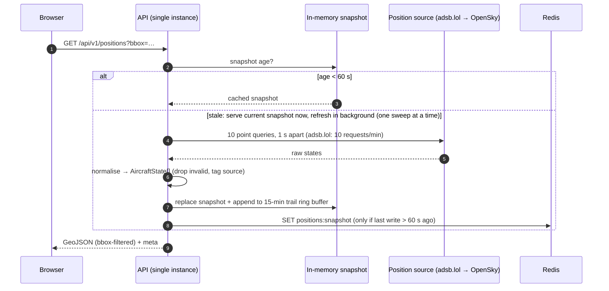
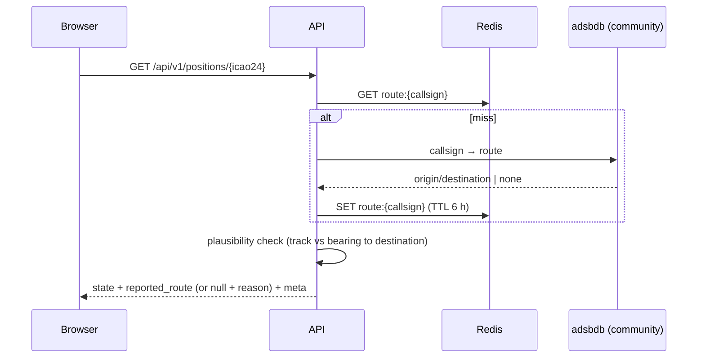

# Flight data flow

Last updated: 2026-11-13. Status: proposed. Open data only, zero budget ([ADR-0004](../decisions/0004-flight-provider-abstraction.md), [ADR-0012](../decisions/0012-zero-budget-hosting.md)).

## Live positions (on demand)



On a **cold start** the API first loads `positions:snapshot` from Redis, if one exists and is under 5 minutes old, so the first visitor sees something immediately, marked with its real age.

### Response `meta`

```json
{
  "mode": "live",               // "live" | "demo" | "degraded" | "unavailable"
  "source": "adsb.lol",
  "source_url": "https://adsb.lol",
  "attribution": "Data © adsb.lol contributors, ODbL",
  "fetched_at": "2026-11-13T13:10:03Z",
  "generated_at": "2026-11-13T13:10:05Z",
  "count": 612
}
```

### Freshness rules

| Age of a position (`now − position_time`) | Behaviour |
|---|---|
| < 90 s | Live (sweeps run once a minute, so 0-70 s is normal) |
| 90 s – 5 min | Labelled "Delayed" with "last seen X ago" |
| > 5 min | Removed from the map. Searchable as "last seen" while still in the trail buffer |

| Age of the whole snapshot | `meta.mode` |
|---|---|
| < 90 s | `live` (or `demo` if the demo provider is configured) |
| 90 s – 5 min | `degraded`, with a banner: "Live data delayed" |
| none or > 5 min | `unavailable`. The map shows basemap and airports with an explanation |

### Source failover

The configured order is `POSITION_PROVIDERS=adsblol,adsbfi,opensky` (the default). If the first fails, the next is tried. A source that answers `429` rests for its `Retry-After` and is skipped until then.

A sweep fails if more than 2 of its 10 regions don't answer, so a half-empty map is never shown as complete.

**Coverage:** the 10-point grid (used for adsb.lol and adsb.fi) reaches every Indian airport with scheduled service except the island airports Agatti (AGX) and Port Blair (IXZ). OpenSky (fallback) covers the whole bounding box but reports no aircraft type or registration. `meta.source` always names the source that actually produced the data. **The demo provider is never in the automatic failover chain** ([ADR-0011](../decisions/0011-demo-mode-is-explicit.md)).

## Selected aircraft: reported route



## Flight page `/flight/[id]`

Open data gives **no schedules or airline status**, so the page is built from what can be observed:

| Section | Source | Shown as |
|---|---|---|
| Live state (position, altitude, speed, heading) | Live snapshot, matched by callsign | "Live", with timestamp |
| Observed state | ADS-B | *Airborne*, *On ground* or *Not currently tracked* |
| Origin and destination | adsbdb | "Reported route (community data)" |
| Estimated arrival | Remaining great-circle distance ÷ ground speed | "Estimated from live position" |
| Recent observed flights | OpenSky `/flights/departure` and `/flights/arrival` (previous days) | "First seen / last seen" times, not scheduled times |
| Scheduled and estimated times, gate, delay, cancellation | — | **"Not available from open data sources"** |

## Airport movements (daily)

- Airport pages show "flights observed yesterday", fetched from OpenSky `/flights/departure` and `/flights/arrival` for that airport's ICAO code over the previous day (UTC).
- Fetched lazily on the first request of the day and cached in Redis for 24 h. That's at most 2 calls × 7 airports a day. *(Planned with the airport pages, Stage 3.)*

## Reported routes (background)

After each sweep, up to 10 callsigns without a cached route are looked up on adsbdb (3 at a time) and cached for 6 h, including "no route" answers. The route list fills in over a few minutes while people are viewing. adsb.lol's batch route endpoint was tested and returns an empty body, so it isn't used.

## Identifier mapping

- Flight number (IATA, `AI101`) ↔ callsign (ICAO, `AIC101`): mapped by the airline's IATA/ICAO prefix pair from the `airlines` table. Suffixes don't always match, so this is a **search hint** only.
- A reported route is hidden when the aircraft's track clearly contradicts it.

## Retention

- **Memory:** latest snapshot plus a 15-minute trail ring buffer.
- **Redis:** warm-start snapshot (TTL 5 min), routes (6 h), airport movements (24 h).
- **Postgres:** no position history on the free tier (`POSITION_HISTORY_ENABLED=false`).
