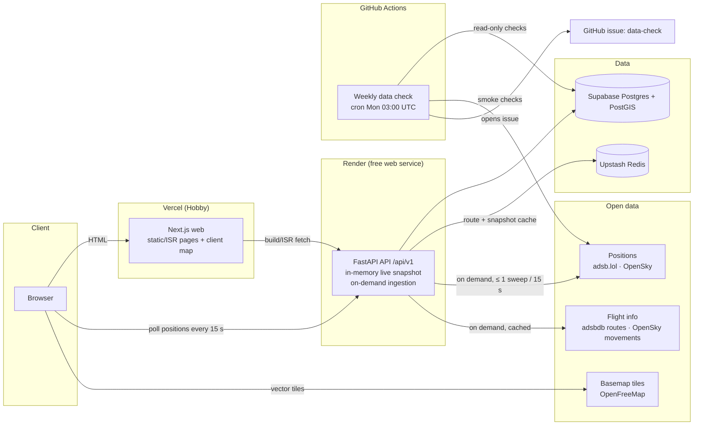

# System architecture

Last updated: 2026-11-13. Status: proposed (Stage 0).

**Constraints:** AeroGuide is non-commercial, has a **zero budget**, and uses **open data only**.

## Overview

AeroGuide is a **modular monolith** ([ADR-0002](../decisions/0002-modular-monolith-monorepo.md)) made of:

- a Next.js web app,
- one FastAPI codebase running as a single API process,
- PostgreSQL + PostGIS for durable data,
- Redis for small shared caches.

Live positions are fetched **on demand** while people are viewing the map ([ADR-0012](../decisions/0012-zero-budget-hosting.md)). Scheduled checks run on GitHub Actions ([ADR-0013](../decisions/0013-weekly-data-check.md)).

## Responsibilities

| Component | Owns | Doesn't do |
|---|---|---|
| **Web** | Rendering, routing, SEO, map UI, client state | Business rules, provider calls, eligibility logic |
| **API** | REST contracts, validation, services, on-demand ingestion with a single-flight lock, in-memory snapshot and rate limits | Background polling while nobody is viewing |
| **Weekly job** | Staleness report, source-link and content-change checks, seed validation, provider smoke checks | Editing any data |
| **Postgres + PostGIS** | Reference and content data, policy versions, provenance, source-check results | Live positions (no history on the free tier) |
| **Redis** | Route cache, airport-movements cache, warm-start snapshot (written ≤ 1/min) | Per-request work (the command budget is 500K a month) |

## Key decisions

| Decision | ADR |
|---|---|
| ADR format | [0001](../decisions/0001-record-architecture-decisions.md) |
| Modular monolith in a monorepo | [0002](../decisions/0002-modular-monolith-monorepo.md) |
| Stack and tooling (pnpm, uv) | [0003](../decisions/0003-technology-stack-and-tooling.md) |
| Provider abstraction, open sources only | [0004](../decisions/0004-flight-provider-abstraction.md) |
| Polling before push | [0005](../decisions/0005-live-updates-polling-first.md) |
| Provenance and verification on content | [0006](../decisions/0006-content-provenance-and-verification.md) |
| Content as reviewed seed files | [0007](../decisions/0007-content-as-reviewed-seed-files.md) |
| Defer AI, keep services tool-ready | [0008](../decisions/0008-defer-ai-integration.md) |
| Deterministic, versioned eligibility engine | [0009](../decisions/0009-deterministic-eligibility-engine.md) |
| MapLibre symbol layer and basemap choice | [0010](../decisions/0010-map-rendering-and-basemap.md) |
| Demo mode is explicit, never an automatic fallback | [0011](../decisions/0011-demo-mode-is-explicit.md) |
| Zero-budget hosting, on-demand ingestion | [0012](../decisions/0012-zero-budget-hosting.md) |
| Weekly data check job | [0013](../decisions/0013-weekly-data-check.md) |

## Cross-cutting concerns

- **Config:** twelve-factor env vars (`pydantic-settings` in the API, `NEXT_PUBLIC_*` only for non-secret values in the web app).
- **Security:** no secrets in the frontend. The OpenSky client credentials and DB URLs live only in the Render, Vercel and GitHub secret stores. CORS allows only the web origin. Per-IP rate limiting (in memory). Strict Pydantic validation. CSP headers.
- **Observability:** JSON logs with request IDs. `/api/v1/health` (liveness) and `/api/v1/health/data` (snapshot age, active source, last upstream error).
- **Time:** stored in UTC and displayed in IST (`Asia/Kolkata`) by default, labelled "IST".
- **Licences:** AeroGuide code is MIT. Third-party data keeps its own licence (for example adsb.lol is ODbL, map data is © OpenStreetMap contributors) and is credited in the UI.
