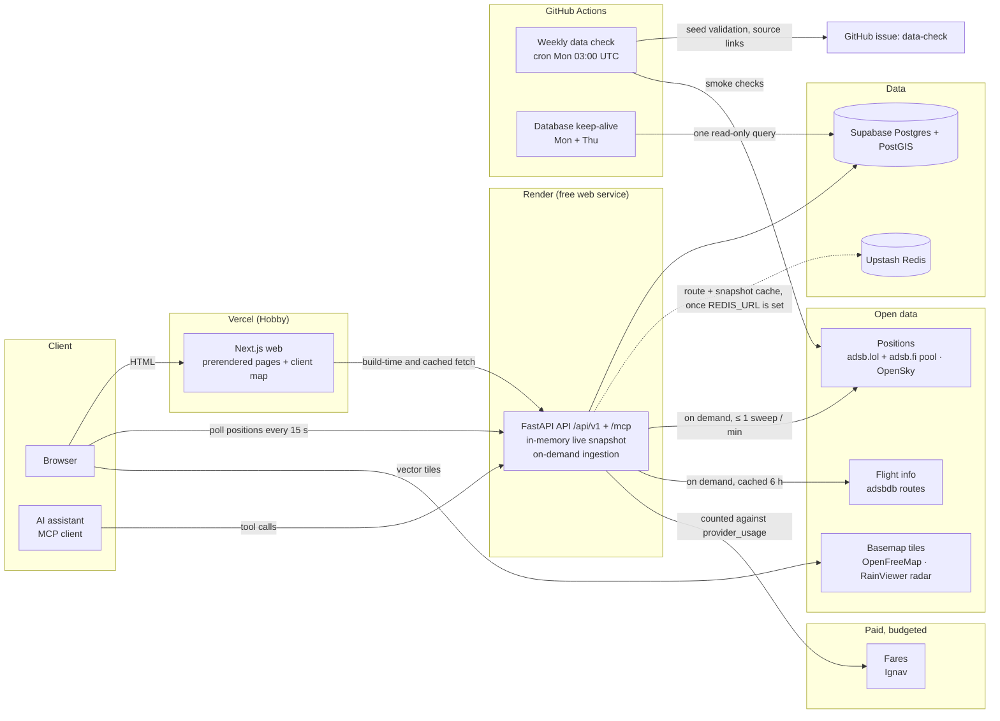

# System architecture

Last updated: 2026-11-16. Status: implemented and deployed.

**Constraints:** AeroGuide is non-commercial, has a **zero budget**, and uses **open data** for everything except fare search, which comes from one paid API inside a hard request budget ([ADR-0015](../decisions/0015-paid-fare-search-with-a-request-budget.md)).

## Overview

AeroGuide is a **modular monolith** ([ADR-0002](../decisions/0002-modular-monolith-monorepo.md)) made of:

- a Next.js web app,
- one FastAPI codebase running as a single API process, which also serves the MCP server for AI assistants at `/mcp` ([ADR-0014](../decisions/0014-mcp-server-for-ai-assistants.md)),
- PostgreSQL + PostGIS for durable data,
- Redis for small shared caches (optional; not connected in production yet).

Live positions are fetched **on demand** while people are viewing the map ([ADR-0012](../decisions/0012-zero-budget-hosting.md)). Scheduled checks run on GitHub Actions ([ADR-0013](../decisions/0013-weekly-data-check.md)).

## Responsibilities

| Component | Owns | Doesn't do |
|---|---|---|
| **Web** | Rendering, routing, SEO, map UI, dead reckoning between updates, client state | Business rules, provider calls, eligibility logic |
| **API** | REST contracts, validation, services, on-demand ingestion with a single-flight lock, in-memory snapshot, rate limits, the fare request budget, MCP tools | Background polling while nobody is viewing |
| **Weekly job** | Staleness report, source-link and content-change checks, seed validation, provider smoke checks | Editing any data, touching the database |
| **Postgres + PostGIS** | Reference and content data, policy versions, provenance, OSM terminals, airline sightings, fare request counts | Live positions (no history on the free tier) |
| **Redis** | Route cache, warm-start snapshot (written ≤ 1/min), fare result cache | Per-request work (the command budget is 500K a month) |

## Key decisions

| Decision | ADR |
|---|---|
| ADR format | [0001](../decisions/0001-record-architecture-decisions.md) |
| Modular monolith in a monorepo | [0002](../decisions/0002-modular-monolith-monorepo.md) |
| Stack and tooling (pnpm, uv) | [0003](../decisions/0003-technology-stack-and-tooling.md) |
| Provider abstraction, open sources only | [0004](../decisions/0004-flight-provider-abstraction.md) |
| Polling before push | [0005](../decisions/0005-live-updates-polling-first.md) |
| Provenance and verification on content | [0006](../decisions/0006-content-provenance-and-verification.md) |
| Content as reviewed seed files | [0007](../decisions/0007-content-as-reviewed-seed-files.md) |
| Defer AI, keep services tool-ready | [0008](../decisions/0008-defer-ai-integration.md) |
| Deterministic, versioned eligibility engine | [0009](../decisions/0009-deterministic-eligibility-engine.md) |
| MapLibre symbol layer and basemap choice | [0010](../decisions/0010-map-rendering-and-basemap.md) |
| Demo mode is explicit, never an automatic fallback | [0011](../decisions/0011-demo-mode-is-explicit.md) |
| Zero-budget hosting, on-demand ingestion | [0012](../decisions/0012-zero-budget-hosting.md) |
| Weekly data check job | [0013](../decisions/0013-weekly-data-check.md) |
| MCP server for AI assistants | [0014](../decisions/0014-mcp-server-for-ai-assistants.md) |
| Paid fare search within a request budget | [0015](../decisions/0015-paid-fare-search-with-a-request-budget.md) |

## Cross-cutting concerns

- **Config:** twelve-factor env vars (`pydantic-settings` in the API, `NEXT_PUBLIC_*` only for non-secret values in the web app).
- **Security:** no secrets in the frontend. The OpenSky client credentials, the Ignav key and DB URLs live only in the Render, Vercel and GitHub secret stores. CORS allows only the configured web origins (`CORS_ORIGINS`). Per-client rate limiting (in memory) and a 16 KB request-body limit. Strict Pydantic validation; the eligibility request rejects unknown fields so a card number can't be sent by mistake. `/mcp` checks the `Host` header against an allow-list.
- **Observability:** JSON logs to stdout. `/api/v1/health` reports database, PostGIS and Redis checks plus the live pipeline (snapshot age, active source, last upstream error, per-provider rest after a rate limit).
- **Time:** stored in UTC and displayed in IST (`Asia/Kolkata`) by default, labelled "IST".
- **Licences:** AeroGuide code is MIT. Third-party data keeps its own licence (for example adsb.lol is ODbL, map data is © OpenStreetMap contributors) and is credited in the UI.
