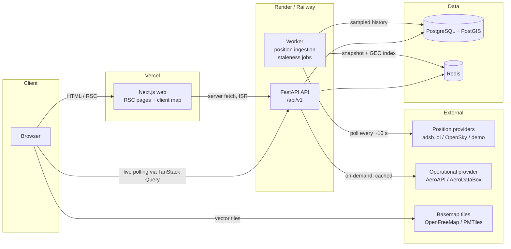

# System architecture

Last updated: 2026-11-13. Status: proposed (Stage 0).

## Overview

AeroGuide is a **modular monolith** ([ADR-0002](../decisions/0002-modular-monolith-monorepo.md)) made of:

- a Next.js web app,
- one FastAPI codebase deployed as two processes (an **API** and a **worker**),
- PostgreSQL + PostGIS for durable data,
- Redis for live positions and caching.

## Responsibilities

| Component | Owns | Doesn't do |
|---|---|---|
| **Web** | Rendering, routing, SEO, map UI, client state | Business rules, holding provider credentials, eligibility logic |
| **API** | REST contracts, validation, services (airports, lounges, cards, eligibility, flights), caching | Polling providers in request paths (except on-demand operational lookups) |
| **Worker** | Polling position providers, normalising, writing Redis, sampling history, staleness reports | Serving HTTP |
| **Postgres + PostGIS** | Reference and content data, policy versions, provenance, sampled positions | Hot live state |
| **Redis** | Latest position snapshot, GEO index, response caches, rate-limit counters | Durable records |

## Key decisions

| Decision | ADR |
|---|---|
| ADR format | [0001](../decisions/0001-record-architecture-decisions.md) |
| Modular monolith in a monorepo | [0002](../decisions/0002-modular-monolith-monorepo.md) |
| Stack and tooling (pnpm, uv) | [0003](../decisions/0003-technology-stack-and-tooling.md) |
| Flight provider abstraction and data classes | [0004](../decisions/0004-flight-provider-abstraction.md) |
| Polling before push | [0005](../decisions/0005-live-updates-polling-first.md) |
| Provenance and verification on content | [0006](../decisions/0006-content-provenance-and-verification.md) |
| Content as reviewed seed files | [0007](../decisions/0007-content-as-reviewed-seed-files.md) |
| Defer AI, keep services tool-ready | [0008](../decisions/0008-defer-ai-integration.md) |
| Deterministic, versioned eligibility engine | [0009](../decisions/0009-deterministic-eligibility-engine.md) |
| MapLibre symbol layer and basemap choice | [0010](../decisions/0010-map-rendering-and-basemap.md) |
| Demo mode is explicit, never an automatic fallback | [0011](../decisions/0011-demo-mode-is-explicit.md) |

## Cross-cutting concerns

- **Config:** twelve-factor env vars (`pydantic-settings` in the API, `NEXT_PUBLIC_*` only for non-secret values in the web app).
- **Security:** provider keys are held only by the API and worker. CORS allows only the web origin. Rate limiting is per IP on public endpoints (Redis token bucket). Strict input validation via Pydantic. CSP headers on the web app.
- **Observability:** JSON logs with request IDs. `/api/v1/health` (liveness) and `/api/v1/health/data` (provider freshness and the age of the last snapshot). Error tracking (Sentry or similar, still to be chosen).
- **Time:** everything is stored in UTC and displayed in IST (`Asia/Kolkata`) by default, labelled "IST".
