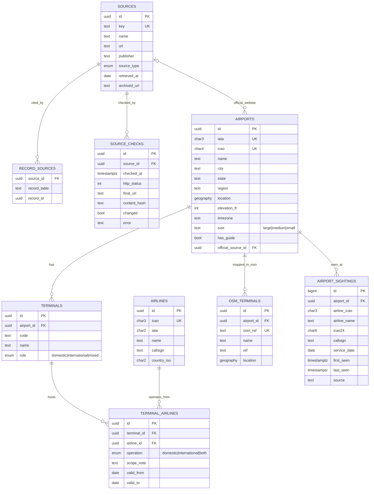
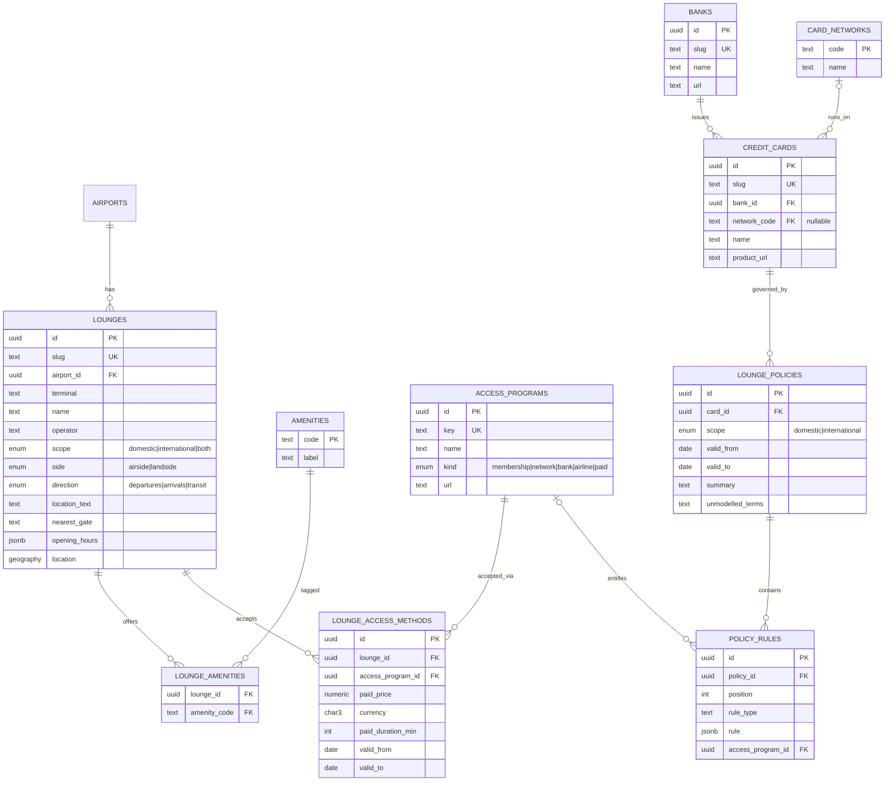
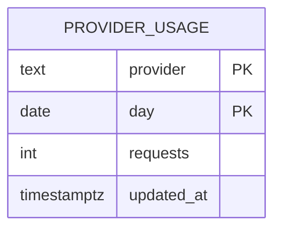

# Entity relationship diagram

Last updated: 2026-11-16. Status: implemented (migrations 0001-0007). Column details are in the [schema](./schema.md) and [data dictionary](./data-dictionary.md).

Tables marked **(P)** use the `Provenance` mixin (`verification_status`, `verified_at`, `verified_by`, `reverify_after_days`, `primary_source_id`, `notes`) from [ADR-0006](../decisions/0006-content-provenance-and-verification.md). The mixin columns and `created_at` / `updated_at` are left out of the diagram for readability.

## Airports, terminals and sources

`osm_terminals` (OpenStreetMap, always `unverified`) and `airport_sightings` (aircraft seen in the live ADS-B snapshot, written by the API, kept 45 days) are deliberately separate from the curated `terminals` and `terminal_airlines`, so mapped or observed data can never be mistaken for a verified terminal assignment.

## Flights

There are no flight tables. Live positions are held in API memory only ([ADR-0012](../decisions/0012-zero-budget-hosting.md)); the `flights` and `flight_positions` tables from the first proposal, like the aircraft reference tables, were not built.

## Lounges and cards

A card variant with different benefits is its own `credit_cards` row, so policies hang off the card directly. Versions of a policy are linked by their dates: no overlap per (`card_id`, `scope`) is enforced by an exclusion constraint.

## Usage

Upstream requests per paid provider per IST day; the fare search budget ([ADR-0015](../decisions/0015-paid-fare-search-with-a-request-budget.md)).

(P) tables: airports, terminals, terminal airlines, OSM terminals, lounges, lounge access methods, credit cards and lounge policies.
