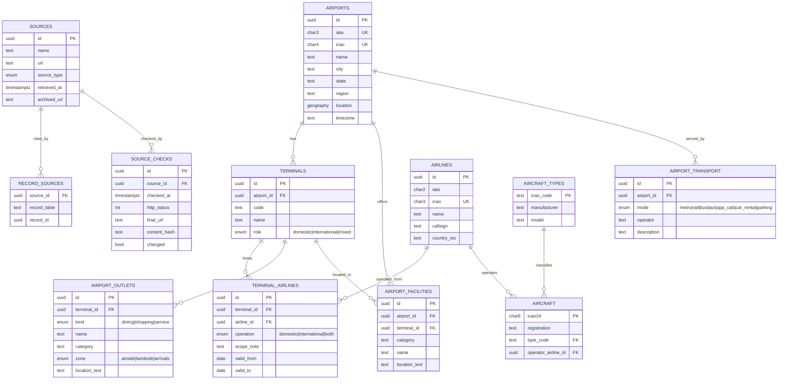
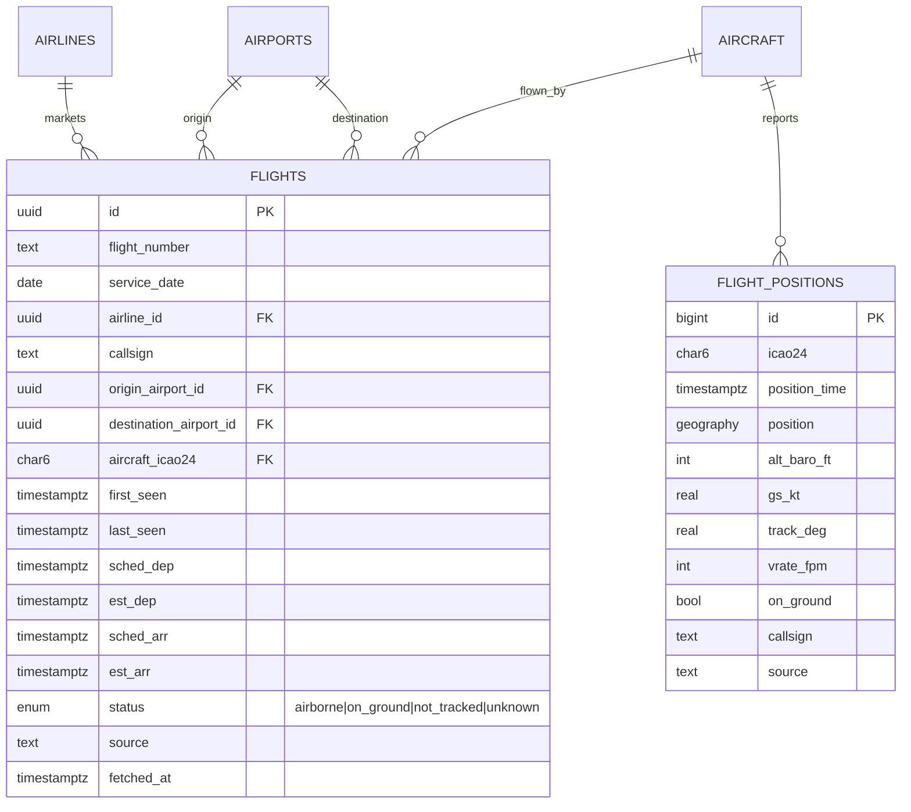
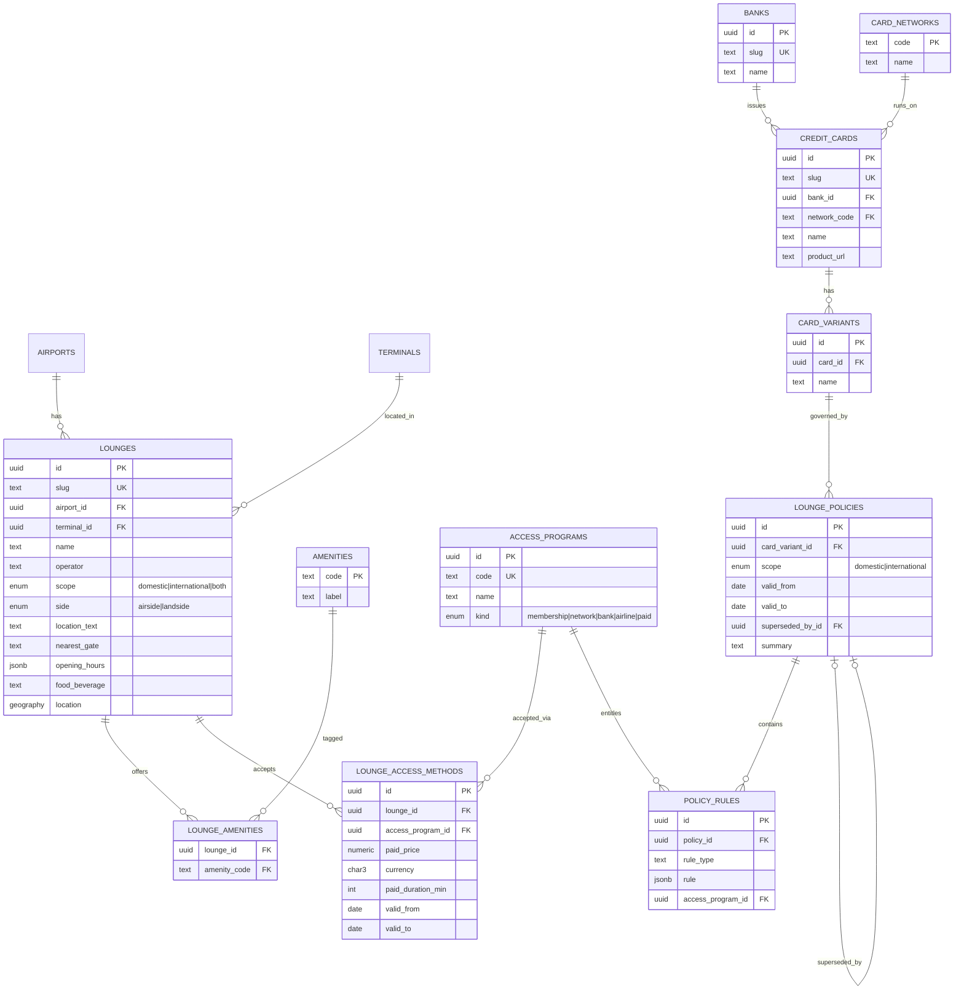

# Entity relationship diagram

Last updated: 2026-11-13. Status: proposed. Column details are in the [schema](./schema.md) and [data dictionary](./data-dictionary.md).

Tables marked **(P)** use the `Provenance` mixin (`verification_status`, `verified_at`, `verified_by`, `reverify_after_days`, `primary_source_id`, `notes`) from [ADR-0006](../decisions/0006-content-provenance-and-verification.md). The mixin columns are left out of the diagram for readability.

## Airports, terminals and aviation reference

## Flights

`flights` holds **observed** movements from open data (OpenSky first-seen and last-seen times, reported routes). The `sched_*` and `est_*` columns stay `null` while only open sources are used. They exist so a schedule source could be added later without a migration.

`flight_positions` is partitioned by day on `position_time` and has no FK to `aircraft`, so ingestion doesn't depend on reference data. **It is disabled on the zero-budget deployment** ([ADR-0012](../decisions/0012-zero-budget-hosting.md)). Trails come from memory instead.

## Lounges and cards

Lounges, lounge access methods, credit cards and lounge policies are (P) tables. So are airports, terminals, terminal airlines, facilities, transport and outlets.
