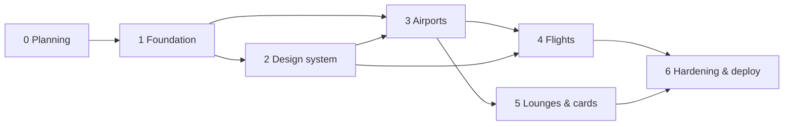

# Development roadmap

Last updated: 2026-11-16. Each stage ends with a runnable app, updated docs, Conventional Commits, and **explicit owner approval before the next stage begins**.

| Stage | Theme | Key deliverables | Exit gate | Status |
|---|---|---|---|---|
| **0** | Research and planning | Reference analysis, PRD, MVP scope, architecture, ERD, provider research, ADRs | Owner approves the docs and resolves blocking decisions | **Done** |
| **1** | Foundation | Monorepo (pnpm + uv), Next.js app, FastAPI app, Postgres+PostGIS and Redis via Docker Compose, `/api/v1/health`, lint, format, type check, CI workflow, `.env.example`, Makefile | `make dev` starts everything. CI green | **Done** (CI green on every push) |
| **2** | Frontend design system | App shell, nav, footer, theme tokens, shadcn/ui components, homepage layout (with real empty states, no fake data), loading, error and empty patterns | Lighthouse a11y ≥ 95 on shell pages | **Done** (axe clean in both themes) |
| **3** | Airports | Homepage search (airports by name, code or city), SQLAlchemy models and migrations (airports, terminals, airlines, sources, source checks), seed loader with provenance validation, airport search and detail APIs, directory and detail pages, **weekly data-check workflow** (staleness + source links) | 7 airports seeded with sourced data. Unverified sections labelled. The weekly job opens its first issue | **Shipped.** 116 airports (OurAirports geodata, unverified), 7 guide files, search and detail APIs, directory and guide pages, weekly data check, deploy-data workflow, OpenStreetMap terminals and airlines seen in ADS-B data as labelled substitutes. **Content still to do:** verified terminal assignments for the 7 airports |
| **4** | Flight tracking | Provider interface, Demo, adsb.lol and OpenSky position adapters, adsbdb route adapter, OpenSky movements adapter, on-demand ingestion with single-flight lock, positions API, MapLibre live map, panel, search, filters, staleness, cold-start state, flight detail page (open data only), provider smoke checks added to the weekly job | Live map works in live and demo modes. Source swap is config-only. $0 cost | **Shipped:** live map homepage, positions API with adsb.lol and adsb.fi as one point-by-point failover pool and OpenSky (API client) as fallback, dead reckoning between updates, searchable From/To filters, routes, weather and airport layers, watch alerts, per-provider status in `/api/v1/health`. Still to do: flight detail page, airline and observed-state filters, OpenSky airport movements |
| **5** | Lounges and cards | Lounge models and pages, access programmes, banks, cards, versioned policies, eligibility engine and API, checker UI, comparison (P1) | Engine has property-based and table-driven tests on every rule type | **Shipped:** schema and migrations 0004 to 0006, engine with table-driven and property tests, lounge, card, programme, search and eligibility APIs, two-way lounge and card pages, checker. 15 verified launch cards, 61 imported cards waiting for a check, 44 lounges at 7 airports. Comparison (P1) not started |
| **6** | Hardening and deploy | Unit, integration and e2e coverage, performance pass, security review, free-tier deploys (Vercel Hobby, Render free, Supabase free, Upstash free), monitoring | Production deploy at $0. Docs complete | **In progress:** production at $0 on Vercel, Render, Supabase (Upstash Redis created, not yet connected). Rate limits, body caps, database timeouts and keep-alive, SEO metadata and sitemap, e2e tests for every section done. Monitoring and a formal security review still to do |
| — | Fare search | Ignav fare search on Indian domestic routes with a hard request budget ([ADR-0015](../decisions/0015-paid-fare-search-with-a-request-budget.md)), `/fares` page, MCP tool | Free allowance never exceeded without an owner decision | **Shipped** |
| Future | AI phase | Read-only MCP server for AI assistants shipped ([ADR-0014](../decisions/0014-mcp-server-for-ai-assistants.md)) | — | **MCP shipped**; anything more not planned |

## Stage dependencies

Stage 4 needs the airports table (for the airport layer and route endpoints), and Stage 5 needs airports and terminals. Stages 4 and 5 can run in parallel once Stage 3 is done.

## Content workstream (runs alongside engineering)

Engineering can't finish Stages 3 and 5 without verified content. Data collection for the 7 airports, their lounges and the first card set should start **as soon as Stage 0 is approved**, following the [source research](../research/).
