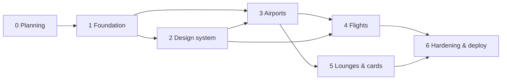

# Development roadmap

Last updated: 2026-11-13. Each stage ends with a runnable app, updated docs, Conventional Commits, and **explicit owner approval before the next stage begins**.

| Stage | Theme | Key deliverables | Exit gate | Status |
|---|---|---|---|---|
| **0** | Research and planning | Reference analysis, PRD, MVP scope, architecture, ERD, provider research, ADRs | Owner approves the docs and resolves blocking decisions | **Done, awaiting approval** |
| **1** | Foundation | Monorepo (pnpm + uv), Next.js app, FastAPI app, Postgres+PostGIS and Redis via Docker Compose, `/health` and `/api/v1/health`, lint, format, type check, CI workflow, `.env.example`, Makefile | `make dev` starts everything. CI green | Not started |
| **2** | Frontend design system | App shell, nav, footer, theme tokens, shadcn/ui components, homepage layout (with real empty states, no fake data), loading, error and empty patterns | Lighthouse a11y ≥ 95 on shell pages | Not started |
| **3** | Airports | SQLAlchemy models and migrations (airports, terminals, airlines, sources), seed loader with provenance validation, airport search and detail APIs, directory and detail pages | 7 airports seeded with sourced data. Unverified sections labelled | Not started |
| **4** | Flight tracking | Provider interface, Demo, adsb.lol and OpenSky adapters, ingestion worker → Redis, positions API, MapLibre live map, panel, search, filters, staleness, flight detail page, operational provider adapter (if approved) | Live map works in live and demo modes. Provider swap is config-only | Not started |
| **5** | Lounges and cards | Lounge models and pages, access programmes, banks, cards, versioned policies, eligibility engine and API, checker UI, comparison (P1) | Engine has property-based and table-driven tests on every rule type | Not started |
| **6** | Hardening and deploy | Unit, integration and e2e coverage, performance pass, security review, Vercel, Render/Railway and Supabase deploys, monitoring | Production deploy behind a feature flag. Docs complete | Not started |
| Future | AI phase (separate project) | Expose services as controlled tools (see [ADR-0008](../decisions/0008-defer-ai-integration.md)) | — | Not planned |

## Stage dependencies

Stage 4 needs the airports table (for the airport layer and route endpoints), and Stage 5 needs airports and terminals. Stages 4 and 5 can run in parallel once Stage 3 is done.

## Content workstream (runs alongside engineering)

Engineering can't finish Stages 3 and 5 without verified content. Data collection for the 7 airports, their lounges and the first card set should start **as soon as Stage 0 is approved**, following the [source research](../research/).
