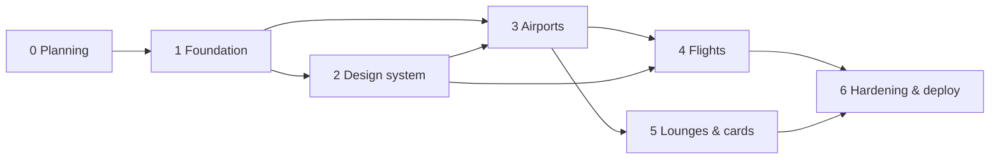

# Development roadmap

Last updated: 2026-11-13. Each stage ends with a runnable app, updated docs, Conventional Commits, and **explicit owner approval before the next stage begins**.

| Stage | Theme | Key deliverables | Exit gate | Status |
|---|---|---|---|---|
| **0** | Research and planning | Reference analysis, PRD, MVP scope, architecture, ERD, provider research, ADRs | Owner approves the docs and resolves blocking decisions | **Done** |
| **1** | Foundation | Monorepo (pnpm + uv), Next.js app, FastAPI app, Postgres+PostGIS and Redis via Docker Compose, `/health` and `/api/v1/health`, lint, format, type check, CI workflow, `.env.example`, Makefile | `make dev` starts everything. CI green | **Done** (CI to be confirmed on first push) |
| **2** | Frontend design system | App shell, nav, footer, theme tokens, shadcn/ui components, homepage layout (with real empty states, no fake data), loading, error and empty patterns | Lighthouse a11y ≥ 95 on shell pages | **In review** (Lighthouse a11y 100; axe clean in both themes) |
| **3** | Airports | Homepage search (airports by name, code or city), SQLAlchemy models and migrations (airports, terminals, airlines, sources, source checks), seed loader with provenance validation, airport search and detail APIs, directory and detail pages, **weekly data-check workflow** (staleness + source links) | 7 airports seeded with sourced data. Unverified sections labelled. The weekly job opens its first issue | **In review:** schema and migration, seed loader with provenance validation, 116 airports (OurAirports geodata, unverified), 7 guide files with official websites (BOM's not yet confirmed), search and detail APIs, directory and guide pages, map airport search, weekly data check and deploy-data workflows. Terminals as mapped in OpenStreetMap and airlines seen in ADS-B data are shown as unverified substitutes. **Content still to do:** verified terminal assignments for the 7 airports, checked against official sources by a person |
| **4** | Flight tracking | Provider interface, Demo, adsb.lol and OpenSky position adapters, adsbdb route adapter, OpenSky movements adapter, on-demand ingestion with single-flight lock, positions API, MapLibre live map, panel, search, filters, staleness, cold-start state, flight detail page (open data only), provider smoke checks added to the weekly job | Live map works in live and demo modes. Source swap is config-only. $0 cost | **In review, pulled ahead of Stage 3 (owner, 2026-11-13):** live map homepage, positions API, providers, routes, weather and airport layers, watch alerts. Still to do: flight detail page, OpenSky airport movements, weekly-job provider checks |
| **5** | Lounges and cards | Lounge models and pages, access programmes, banks, cards, versioned policies, eligibility engine and API, checker UI, comparison (P1) | Engine has property-based and table-driven tests on every rule type | **In review (5a + 5b shipped first, owner 2026-11-14):** schema and migration 0004, seed format with validation, deterministic engine with table-driven and property tests, lounge, card, programme and eligibility APIs, lounge and card pages, checker (keeps nothing; no card numbers), lounges on airport guides. **Content still to do:** the launch set ([card-launch-set.md](../research/card-launch-set.md)) and lounges at the 7 airports, through reviewed PRs. OpenStreetMap lounges were dropped: only 5 are mapped across India |
| **6** | Hardening and deploy | Unit, integration and e2e coverage, performance pass, security review, free-tier deploys (Vercel Hobby, Render free, Supabase free, Upstash free), monitoring | Production deploy at $0. Docs complete | Not started |
| Future | AI phase (separate project) | Expose services as controlled tools (see [ADR-0008](../decisions/0008-defer-ai-integration.md)) | — | Not planned |

## Stage dependencies

Stage 4 needs the airports table (for the airport layer and route endpoints), and Stage 5 needs airports and terminals. Stages 4 and 5 can run in parallel once Stage 3 is done.

## Content workstream (runs alongside engineering)

Engineering can't finish Stages 3 and 5 without verified content. Data collection for the 7 airports, their lounges and the first card set should start **as soon as Stage 0 is approved**, following the [source research](../research/).
